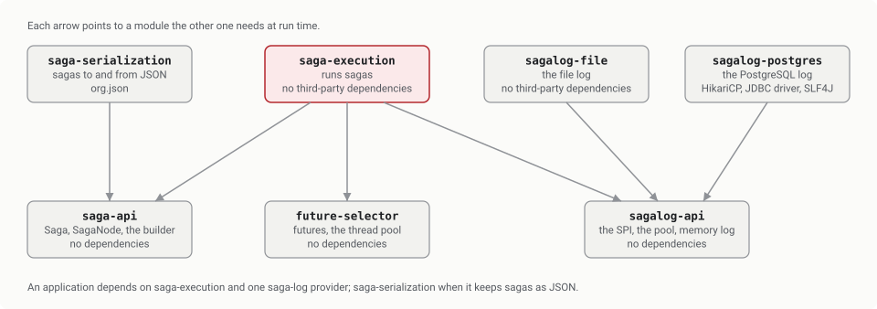

# Architecture

## Modules

The repository is one Maven reactor (`pom.xml` at the root). Every library module has the same version.



| Module | Depends on (inside the project) | Third-party runtime dependencies |
|---|---|---|
| `future-selector` | none | none |
| `saga-api` | none | none |
| `sagalog-api` | none | none |
| `saga-execution` | `saga-api`, `sagalog-api`, `future-selector` | none |
| `saga-serialization` | `saga-api` | `org.json:json` |
| `sagalog-file` | `sagalog-api` | none (it has its own copy of Tape's `QueueFile`, see [NOTICE](https://github.com/Cantara/distributed-saga/blob/main/NOTICE)) |
| `sagalog-postgres` | `sagalog-api` | HikariCP, PostgreSQL JDBC driver, SLF4J API |
| `saga-samples/polyglot-persistence` | all modules except `sagalog-postgres` | Undertow, org.json |
| `saga-fault-matrix` (tests only, not deployed) | `saga-execution` and every saga-log provider | embedded PostgreSQL (test) |

`saga-parent` is a pom-only module that the library modules use as their parent. It adds nothing to the root pom.

An application typically depends on `saga-execution` and one saga-log provider. It adds `saga-serialization` when it
stores or exchanges saga definitions as JSON.

## Java modules (JPMS)

Every library module is a named Java module with a `module-info.java`.

| Java module | Exports | Requires | Service |
|---|---|---|---|
| `no.cantara.concurrent.futureselector` | `no.cantara.concurrent.futureselector` | `java.base` | |
| `no.cantara.saga.api` | `no.cantara.saga.api` | `java.base` | |
| `no.cantara.sagalog` | `no.cantara.sagalog` | `java.base` | provides `SagaLogInitializer` (memory log) |
| `no.cantara.saga.execution` | `no.cantara.saga.execution`, `...execution.adapter` | `transitive` saga-api, sagalog, futureselector | uses `SagaLogInitializer` |
| `no.cantara.saga.serialization` | `no.cantara.saga.serialization` | `transitive` saga-api; `org.json` | |
| `no.cantara.sagalog.file` | nothing | `no.cantara.sagalog` | provides `SagaLogInitializer` (file log) |
| `no.cantara.sagalog.postgres` | `no.cantara.sagalog.postgres` (the initializer and `PostgresSagaLogException`) | `transitive` sagalog; `java.sql`, `com.zaxxer.hikari`, `org.slf4j` | provides `SagaLogInitializer` (PostgreSQL log) |

Notes:

- `requires transitive` means a module that requires `no.cantara.saga.execution` can use `Saga`, `SagaLog` and
  `SelectableFuture` without requiring their modules itself.
- The provider modules export nothing an application needs to call: it reaches them through `ServiceLoader` and the
  `SagaLogInitializer` interface (see below). `sagalog-postgres` exports its package only so that
  `PostgresSagaLogException` can be caught by type. No package is `opens`: nothing reflects on them.
- Every module a library module requires is an explicit module with its own descriptor, so the libraries can be
  linked into a custom runtime with jlink (below).
- The PostgreSQL JDBC driver is not required by `no.cantara.sagalog.postgres`. It is an automatic module (no
  descriptor, only an `Automatic-Module-Name`), which jlink rejects, so the module finds the driver at run time by
  class name. The application provides it; Maven brings it in as a runtime dependency of `sagalog-postgres`.
- The libraries also work on the class path.

### jlink

All seven library modules, with HikariCP, SLF4J and org.json, link into a custom runtime image. Put the PostgreSQL
JDBC driver on the class path of that runtime, because jlink cannot include an automatic module:

```shell
jlink --module-path $JAVA_HOME/jmods:<library jars>:<HikariCP>:<slf4j-api>:<your app> \
      --add-modules <your app module> --output image
image/bin/java -cp postgresql-42.7.x.jar -m <your app module>/<main class>
```

The driver is found through the class path from inside the image. Without the driver, opening a PostgreSQL saga-log
pool fails with `IllegalStateException` saying that the driver is not on the class path or the module path.
`PostgresSagaLogModuleGraphTest` fails the build if a module in `sagalog-postgres`'s graph is automatic.

## Saga-log providers and service loading

A saga-log implementation is a *provider*: a `SagaLogInitializer` registered as a Java service, both in
`module-info.java` (`provides`) and in `META-INF/services/no.cantara.sagalog.SagaLogInitializer`. An application
picks one by class name:

```java
SagaLogInitializer initializer = ServiceLoader.load(SagaLogInitializer.class).stream()
        .filter(p -> p.type().getName().equals("no.cantara.sagalog.file.FileSagaLogInitializer"))
        .findFirst().orElseThrow().get();
SagaLogPool pool = initializer.initialize(configuration);
```

| Provider class | Module | Configuration keys |
|---|---|---|
| `no.cantara.sagalog.memory.MemorySagaLogInitializer` | `sagalog-api` | `cluster.instance-id` |
| `no.cantara.sagalog.file.FileSagaLogInitializer` | `sagalog-file` | `filesagalog.folder`, `cluster.instance-id` |
| `no.cantara.sagalog.postgres.PostgresSagaLogInitializer` | `sagalog-postgres` | `cluster.owner`, `cluster.name`, `cluster.instance-id`, `postgres.driver.*`, `postgres.statement-timeout`, `postgres.lock-timeout`, `connection-pool.*` |

`configurationOptionsAndDefaults()` on each initializer returns its keys with example values. In a modular
application, the module that calls `ServiceLoader.load` must declare `uses no.cantara.sagalog.SagaLogInitializer`.
When the libraries are put in a shaded ("fat") jar, the service files must be merged (for the Maven Shade plugin,
`ServicesResourceTransformer`), or only one provider is found.

## Threading

`SagaExecution` runs on a `SelectableThreadPoolExecutor` that the caller creates and owns (from
`future-selector`). The library starts no threads of its own.

- A saga execution is a set of *walks*. One walk starts at `S`. When a node has several outgoing nodes, the walk
  submits a new walk to the pool for each extra branch, and continues down the last one itself.
- A node with several incoming nodes (a join) waits on no thread. Each incoming node, when done, signals it, and
  the walk of the last one to be done continues into the join; the walks of the others end there. A join receives
  the output of every incoming node.
- Every saga-log write is joined before the walk continues.
- Each action runs on the pool thread of the walk that reached it.
- A walk that fails stops the traversal: no walk starts a new node, and the nodes that depend on the failed one are
  never started. A failed saga completes once its last walk has ended.
- After an abort, the rollback starts once every forward walk has ended, on the thread of the last one; its first
  backward walk runs on that thread too.

Walks hold pool threads while they run actions and while they wait for saga-log writes and reads, so the pool's
size is how many branches run at once. A join holds no thread, so a pool smaller than the branches makes sagas slower,
not stuck. The application limits how many sagas run at once. A `ThreadPoolExecutor` with an unbounded queue never
grows beyond its core size, so set the core size for the expected parallelism. See
[Known limitations](limitations.md#thread-starvation).

`onComplete` runs on the pool thread that completes the saga. Blocking in it holds that thread. The pool's rejection policy must not
run tasks on the submitting thread; see [Known limitations](limitations.md#the-executor-rejection-shutdown-and-caller-runs).

## Life of one saga execution

```
caller                     SagaExecution / pool threads                      SagaLog
  │ executeSaga(id, input)        │                                               │
  │──────────────────────────────►│ walk at S: write Start(S, name, input) ──────►│
  │◄─── handoff future completes ─│                                               │
  │                               │ walks: for each node                          │
  │                               │   write Start(node) ─────────────────────────►│
  │                               │   adapter.executeAction(...)                  │
  │                               │   write End(node, output) ───────────────────►│
  │                               │ walk at E: write End(E) ─────────────────────►│
  │                               │ onComplete(result)                            │
  │◄─ completion future completes─│                                               │
```

On `AbortSagaException`, the walk writes `Abort` on its node and the backward walk writes `CompStart` and `Comp` for
each compensated node and `End` on `E`, before `onComplete` and the completion future (see [Concepts](concepts.md#rollback)).

## Where the state lives

- The `Saga` definition is immutable (its node links cannot be changed after `end()`) and is shared by every
  execution. The adapters are immutable from the library's point of view and are shared too.
- All state of a running execution is in memory, in the traversal, and in the saga log.
- Only the saga log survives a restart. Whatever recovery needs must be in the log: the saga name, the input, and
  each completed node's output.
