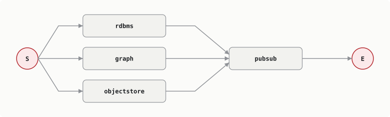

# Concepts

## The saga pattern

A saga splits one long-lived operation into steps. Each step has an *action* and a *compensating action* that undoes
it. If every action succeeds, the saga has succeeded. If one action fails in a way that means the whole operation
must be undone, the compensating actions of the steps that already ran are executed, and the saga ends rolled back.

There is no distributed transaction and no locking across the systems the steps talk to. Consistency comes from two
rules: every step is recorded in a durable log before and after it runs, and every completed step can be undone.

This library runs sagas *in one process* (orchestration). The steps may call any number of other systems: databases,
queues, services. That is what makes the saga "distributed". There is no coordinator service and no messaging between
saga participants. The only cross-process mechanism is the ownership of a saga log (see [sagalog-api](modules/sagalog-api.md)).

Background reading is listed under "Related work" in the [README](https://github.com/Cantara/distributed-saga/blob/main/README.md#related-work).

## Saga

A `Saga` (`no.cantara.saga.api.Saga`) is a named, directed acyclic graph (DAG) of nodes. It always has:

- a start node with id `S` (`Saga.ID_START`) and adapter `SagaStart`, and
- an end node with id `E` (`Saga.ID_END`) and adapter `SagaEnd`.

Every other node is a step. A link from node A to node B means "B runs after A". A node with several incoming links
runs only after all of them have completed, so independent branches run in parallel.

A saga is built with a fluent builder and validated when it is built: every link must point to a node that exists,
the graph must have no cycle, and every node must be reachable from `S`. A `Saga` is a definition; the same instance
can be executed any number of times. See [saga-api](modules/saga-api.md).

## Node and adapter

A `SagaNode` has an `id`, unique in its saga, and the name of an *adapter*. The adapter is the code that runs for the
node. Adapters implement `SagaAdapter<OUTPUT>` (`no.cantara.saga.execution.adapter`):

- `name()`: the name nodes refer to. It is stored in serialized sagas, so changing it breaks existing definitions.
- `executeAction(node, sagaInput, dependeesOutput)`: the action. It receives the saga's input and the outputs of the
  nodes it depends on, and returns its own output.
- `executeCompensatingAction(node, sagaInput, actionOutput)`: undoes the action, given the action's output (`null`
  when the action started but never ended: it may or may not have run). Must be safe to call more than once.
- `hasCompensatingAction()`: whether the adapter has a compensating action. Rollback runs and logs only those that
  do; the effect of a step without one stays. `Adapter` answers it from how it was built (see
  [saga-execution](modules/saga-execution.md#adapters)); a direct `SagaAdapter` implementation must answer it.
- `serializer()`: turns the output into text for the saga log and back.

Adapters must be stateless and thread-safe: one adapter instance serves every node that names it, in every saga, on
many threads. Adapters are registered by name in an `AdapterLoader`. See [saga-execution](modules/saga-execution.md).

## Saga input and output

The *saga input* is any object the caller passes when a saga starts. Every action receives it. It is serialized by the
start adapter and stored in the log's first entry.

Each action's *output* is serialized by its adapter's serializer and stored in the log when the action ends. Later
nodes receive it as `dependeesOutput`. On rollback, the compensating action receives it, read back from the log if
necessary.

## Saga log

The saga log is an append-only log of `SagaLogEntry` records (`no.cantara.sagalog`). Each entry has:

| Field | Meaning |
|---|---|
| `id` | A `SagaLogEntryId`, chosen by the log implementation; increases in write order within one log |
| `executionId` | The id of one execution of a saga, chosen by the caller |
| `entryType` | `Start`, `End`, `Abort`, `CompStart`, `Comp` or `Ignore` |
| `nodeId` | The node the entry is about (`S` and `E` for the saga itself) |
| `sagaName` | Set on the saga's first entry only |
| `jsonData` | The saga input (first entry) or an action's serialized output (`End` of a node); despite the name, any text |

One execution writes this sequence:

| When | Entry |
|---|---|
| The saga starts | `Start` on `S`, with the saga name and the serialized input |
| Before each action | `Start` on the node |
| After each action | `End` on the node, with the serialized output |
| An action aborts | `Abort` on that node |
| Before each compensating action | `CompStart` on the node |
| After each compensating action | `Comp` on the node |
| The saga is finished, after success or after rollback | `End` on `E` |

A saga is *finished* when its execution has an `End` entry on `E`. A log holds the entries of every execution written
since it was last truncated. Reading returns entries in the order they were written.

Several log implementations exist behind one service-provider interface: in memory, in a file, and in PostgreSQL. See
[sagalog-api](modules/sagalog-api.md).

## Saga-log pool and ownership

A `SagaLogPool` manages many saga logs. A log must have one writer at a time, so a log is used only after taking
*ownership* of it. A pool hands out logs that belong to this application instance and connects to any log in the
cluster for recovery. Each log id has a *cluster instance id* and a *log name*. See
[sagalog-api](modules/sagalog-api.md#pools-and-ownership).

## Execution

`SagaExecution.executeSaga(...)` runs one execution of a saga on a thread pool:

1. It writes the `Start` entry on `S`, then completes the *handoff future*. From this point the saga is durable: if
   the process dies, the log shows the saga was started.
2. It walks the graph forward. Each node runs once all its incoming nodes are done; independent nodes run in parallel.
3. It writes the `End` entry on `E`, calls the caller's `onComplete` callback, then completes the *completion future*.

The caller can wait for either future: the handoff future for "the saga is safely started", the completion future for
"the saga is finished".

## Rollback

An action that must fail the whole saga throws `AbortSagaException`. The library then:

1. writes `Abort` on that node and stops the forward walk,
2. walks the graph backwards from `E`. For every node whose adapter has a compensating action and whose last entry is
   `Start` or `End` (or `CompStart`, a compensation interrupted earlier), it writes `CompStart`, runs the compensating
   action and writes `Comp`. A node is compensated only after the nodes that depend on it have been compensated. A
   node that ended is compensated with the output of its last `End`. A node that started but did not end is
   compensated with a `null` output; its action is not run again. A node whose last entry is `Abort` (the aborting
   node) or `Comp` is not compensated, and a node whose adapter has no compensating action gets no entries: its
   effect stays.
3. writes `End` on `E`, calls `onComplete` with a failure result, and completes the completion future exceptionally
   with the `AbortSagaException`.

Exceptions other than `AbortSagaException` are not rolled back. See [Known limitations](limitations.md).

## Recovery

If a process stops in the middle of a saga, the log holds an execution without an `End` entry on `E`. *Recovery* runs
that execution again with `recovery = true`, the same `executionId` and the original input:

- the *last* entry of a node decides, since an execution can hold several rounds of the same node (run, compensated,
  run again);
- a node whose last entry is `End` is not run again; the output of that `End` is used;
- every other node runs: not started, last entry `Start` (it may or may not have run), `Abort`, or `CompStart`/`Comp`
  (its effect may have been undone). A new `Start` is written unless the last entry already is one.

The library does not look for unfinished sagas itself. The application reads the logs it owns (or all logs of the
cluster), finds unfinished executions, maps the saga name to its `Saga` definition, deserializes the input, and calls
`executeSaga` again. Recovery always continues forward, also after a crash during a rollback: the steps that were
(being) compensated are run again. See [Using the library](using.md#7-recover-unfinished-sagas)
and [Known limitations](limitations.md).

## What the library guarantees, and what it does not

Guaranteed:

- A node runs only after all nodes it depends on have completed.
- Each step is in the saga log before and after it runs; the `Start` entry on `S` is written before the handoff
  future completes.
- After an `AbortSagaException`, every node that started and has a compensating action is compensated, in reverse
  dependency order, before the saga reports failure.
- A crash at any point, followed by forward recovery, ends with every step's effect in place: a step is skipped only
  if its last entry is `End`.
- The completion future completes only after `onComplete` has returned.
- Within one log, entries are read back in the order they were written.

Not guaranteed:

- Exactly-once execution. An action can run more than once, for example when recovery finds a node started but not
  ended. Actions and compensating actions must be idempotent. Why this is the right choice:
  [Design decisions](design-decisions.md#1-delivery-semantics-at-least-once).
- Isolation. Other parties see the intermediate state while a saga runs.
- Rollback for failures other than `AbortSagaException`, and timeouts. A compensating action that fails stops the
  rollback and leaves the saga for forward recovery.

See [Known limitations](limitations.md) for the details.

### Each operation, at a glance

| Operation | How often | What decides it |
|---|---|---|
| An action | At least once | Recovery skips a step only if its last entry is `End`, and passes on that `End`'s output. A step whose last entry is `Start` (it may or may not have run), `Abort`, `CompStart` or `Comp` runs again; a new `Start` is written unless the last entry already is one. |
| A compensating action | At least once in a rollback that reaches `S`; it may run again | Only after `AbortSagaException`, for a step that started and has one. It gets the output of the step's last `End`, or `null` if the action started but did not end. A crash during a rollback is recovered forward: the step's action runs again, and a later rollback that finds `CompStart` last runs the compensating action again. |
| A step without a compensating action | Never undone | A rollback logs nothing for it: its effect stays. |
| `Start` on `S` | Once per execution | Written by the first `executeSaga`; recovery does not write it again. |
| `End` on `E` | Once per execution | Written when the saga is finished, after success or after a rollback. An execution with it is finished: the application's recovery leaves it alone. |
| A saga-log write | Joined before the saga goes on | A write that fails fails the saga; its entry may or may not be stored, and recovery reads whatever is. PostgreSQL retries a write whose reply was lost with the same entry id, and finding that entry stored counts as success. The file log is on disk when the write returns; the memory log keeps nothing across a crash. |
| The handoff future | Completes once | Normally once `Start` on `S` is in the log (on recovery, when `S` is visited); exceptionally at once, with the execution's first failure. |
| `onComplete` | Once per `executeSaga` call | So a recovered execution calls it again. It runs before the completion future completes. |
| The completion future | Completes once | Normally after `End` on `E` and `onComplete`; exceptionally with the `AbortSagaException` after a rollback, with the first failure, or with `SagaOnCompleteException` when `onComplete` threw after success. |
| `preAction`, `postAction` | Once per visit of a node | A recovered execution visits every node again: `postAction` is called for a step that recovery skips too, with its logged output. |

Exactly-once *effects* come from the steps: [An idempotent step](using.md#an-idempotent-step) shows one, and
[Design decisions](design-decisions.md#1-delivery-semantics-at-least-once) explains why the library runs steps at
least once rather than at most once.
