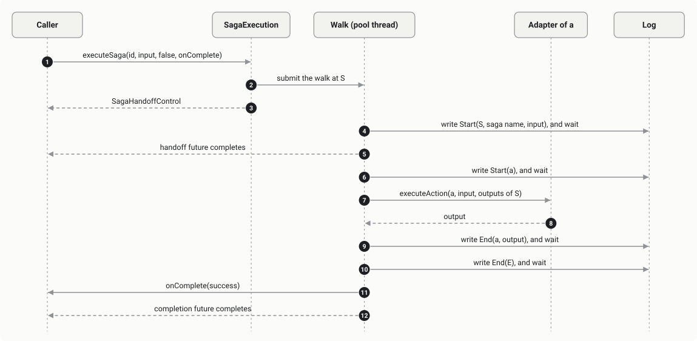
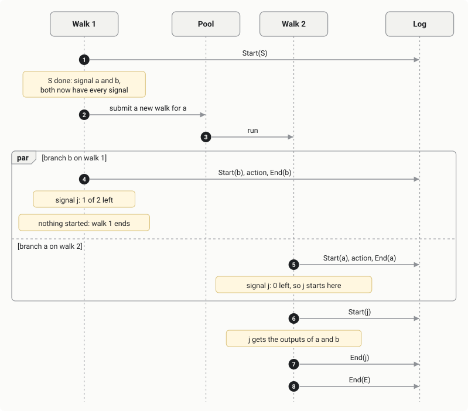
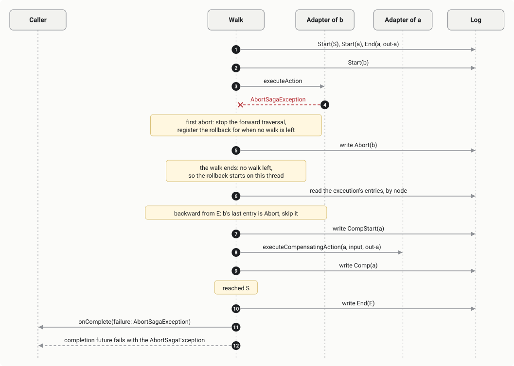
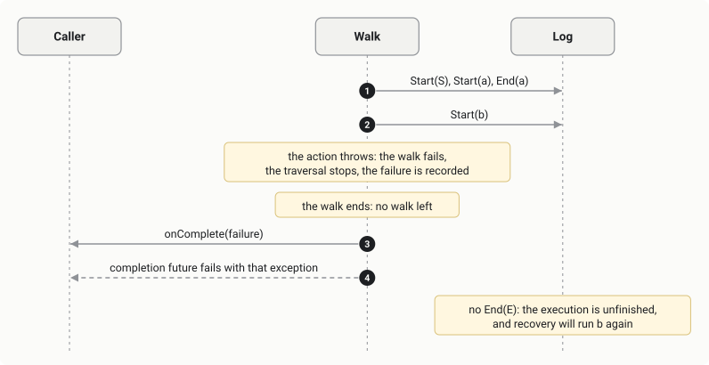
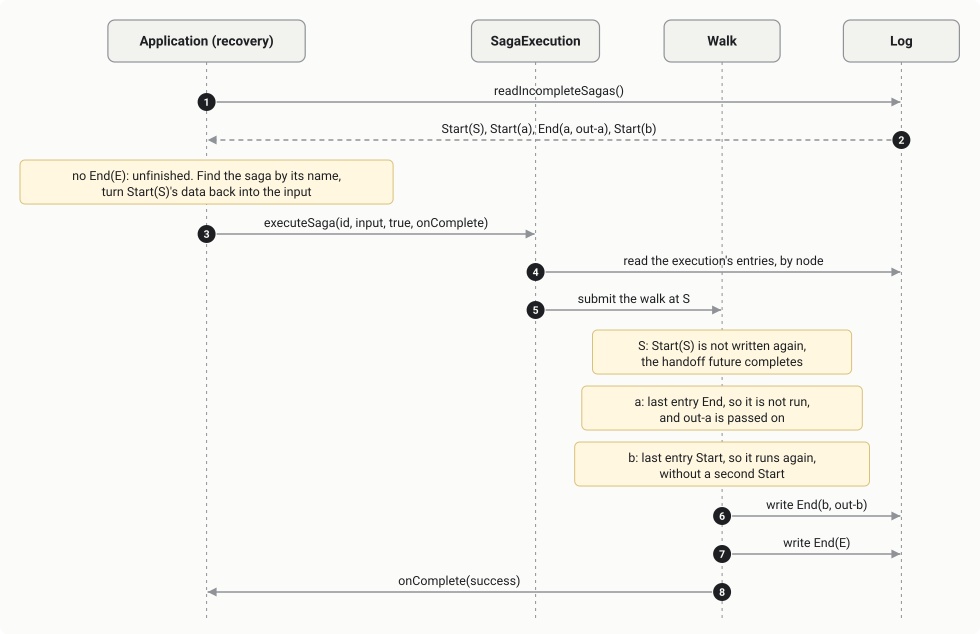
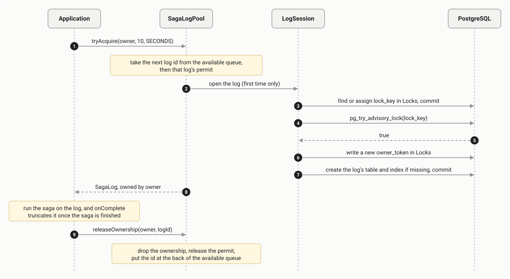
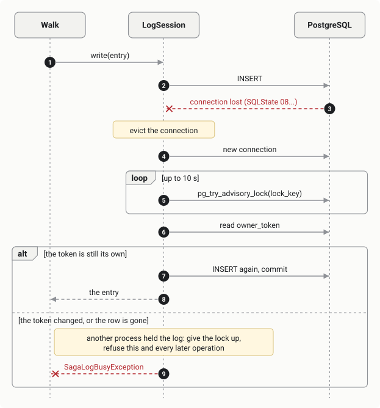
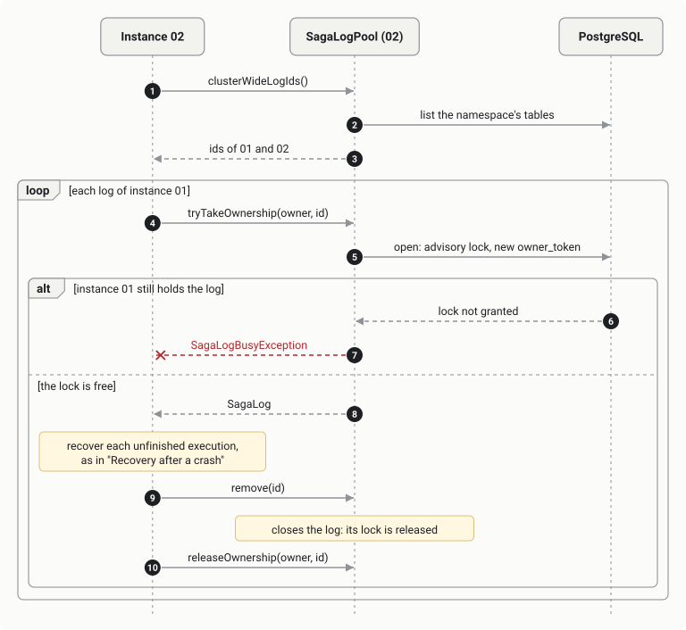

# Sequence flows

Each diagram follows the code, in the order it runs. The rules behind them are in [Protocols](protocols.md).
`Walk` is a task on the application's thread pool; `Log` is the `SagaLog` the execution was given.

## A saga that succeeds

The saga `S -> a -> E`, started with `onComplete` and waited for.

- `executeSaga` returns as soon as the first walk is submitted; everything after runs on the pool.
- The handoff future completes once `Start` on `S` is in the log: from there the saga survives a crash.
- The completion future completes only after `onComplete` has returned. The usual `onComplete` truncates the log
  once the saga is finished (it succeeded, or was rolled back); after any other failure it keeps the entries for
  recovery.
- `preAction` and `postAction`, when given, run before and after each node's visit.

## A fork and a join

The saga `S -> {a, b} -> j -> E`. No walk waits for another; the last node to finish starts the join.

- The walk that visits a node continues into the last node it started, and submits a new walk for each other one.
- Which branch finishes last is a matter of timing. Whichever it is, its walk runs the join; the other walk ends.
- A join holds no thread while it waits, so a pool smaller than the branches makes the saga slower, not stuck.

## An abort and its rollback

The saga `S -> a -> b -> E`, where `b` throws `AbortSagaException`.

- The rollback starts only when every forward walk has ended, so it reads all of their entries.
- A node is compensated with the output of its last `End`, or with `null` if it started but did not end.
- A node whose adapter has no compensating action is skipped, and nothing is logged for it.

## A failure that is not an abort

The same saga, where `b` throws any other exception (a database error, say).

No rollback runs. The log keeps the execution as unfinished, so recovery continues it forward, and `b`, whose last
entry is `Start`, runs again.

## Recovery after a crash

The process stopped after `End(a)` and `Start(b)`. After the restart, the application recovers the execution.

The log now reads `Start(S) Start(a) End(a) Start(b) End(b) End(E)`. Because `b` may have run before the crash too,
its action must be idempotent.

## Taking and releasing a saga log

One saga's use of a log from the pool, with the PostgreSQL provider opening the log the first time it is taken.

- The log stays open, with its connection and its advisory lock, after it is released. The next `tryAcquire` that
  gets it does not open it again.
- If another process holds the advisory lock, the open fails with `SagaLogBusyException`; the id goes to the back of
  the queue, so the next `tryAcquire` hands out another log.
- With the file provider, the open takes the operating-system lock on the log's `.lock` file and reads the file
  instead.

## A PostgreSQL log loses its connection

The database session of an open log ends (a failover, a network reset). Its advisory lock is free from that moment.

The other operations on the log wait meanwhile: a log runs one operation at a time. If the lock cannot be had within
10 s, the operation fails with `SagaLogBusyException`, and the next one tries again.

## Recovering another instance's logs

Instance 02 recovers the sagas of instance 01, which is gone. Both use the same PostgreSQL schema and cluster name.

A live instance keeps its logs locked, so a recovery trigger can run on every instance at any time: it can only take
the logs of instances that are gone.
