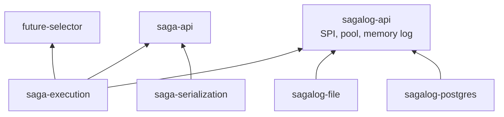
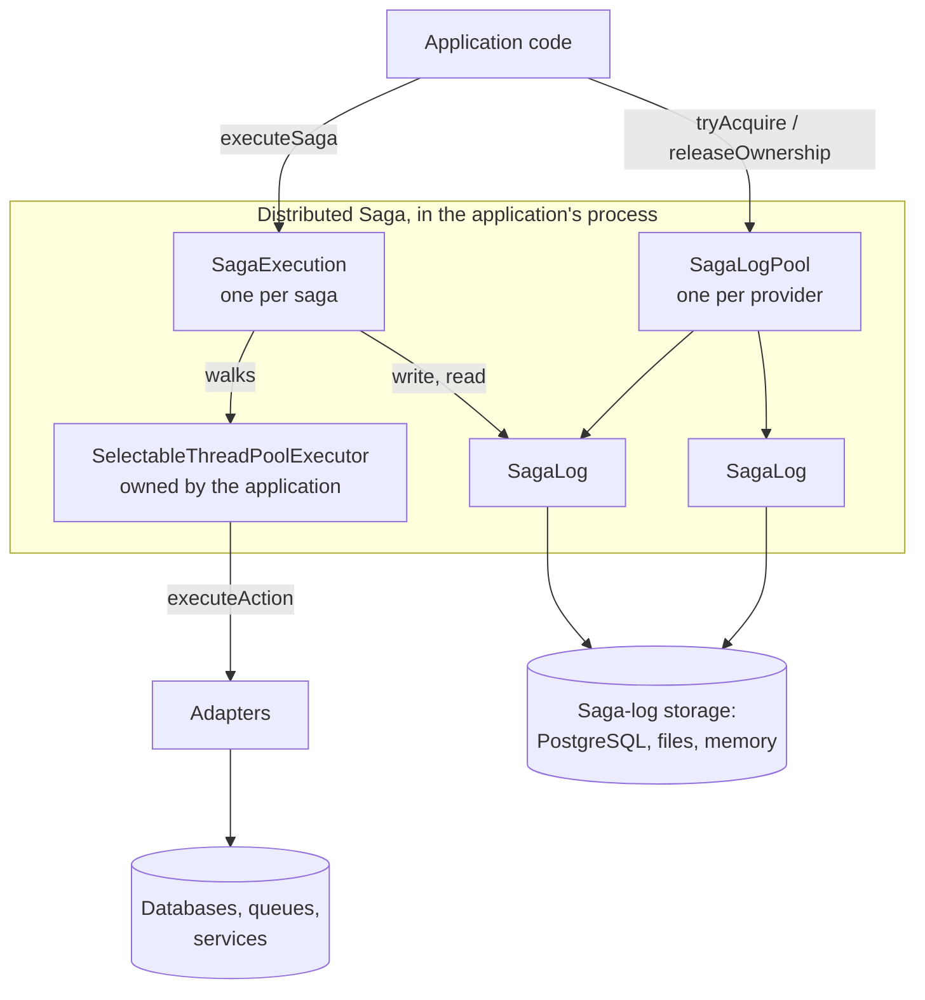
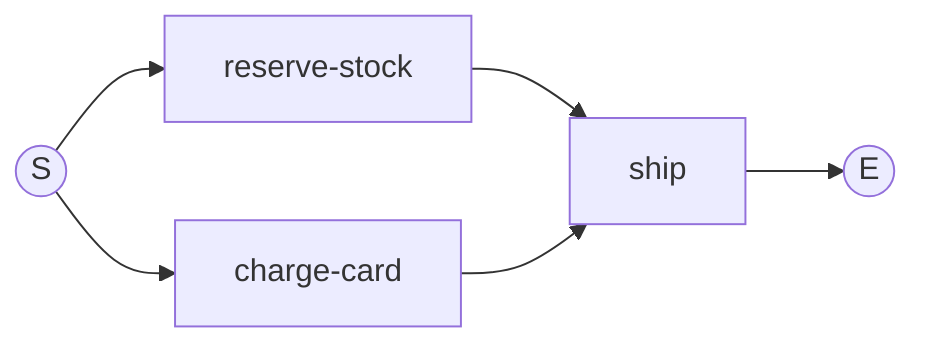
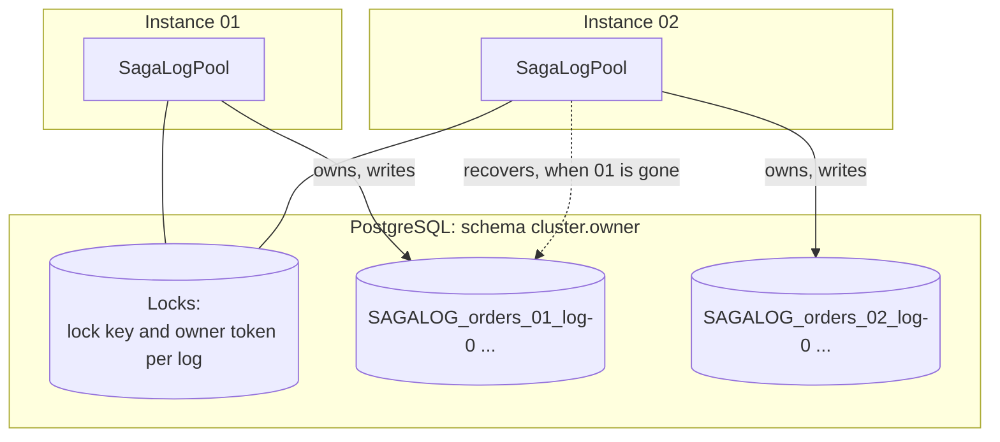

# Topology

Distributed Saga is a library inside an application, not a service beside it. There is no coordinator, no broker
and no network traffic between instances. The topology is therefore three things: how the modules depend on each
other, how the objects connect inside one application instance, and what the instances of a cluster share, which is
only their saga logs.

## Modules

The arrows point from a module to what it needs. `future-selector`, `saga-api` and `sagalog-api` depend on nothing.
The providers depend only on `sagalog-api`, never on each other or on the engine, and the engine finds them through
`ServiceLoader`. Third-party dependencies, the Java module names and the jlink setup are in
[Architecture](architecture.md#modules).

## Inside one application instance

| Object | How many | Owned by | Shared by |
|---|---|---|---|
| `Saga` | One per saga definition | The application | Every execution of that saga |
| `AdapterLoader` and its adapters | Usually one | The application | Every node that names an adapter, in every execution, on every thread |
| `SelectableThreadPoolExecutor` | One or more | The application, which sizes and shuts it down | Every execution given it |
| `SagaLogPool` | One per provider | The application | Every saga of the instance, and recovery |
| `SagaLog` | As many as sagas may run at once | Its owner in the pool, while it holds it | One writer at a time |
| `SagaExecution` | One per saga and log | The application | Its executions |

The usual pattern ([Using the library](using.md)): register a fixed set of instance-local logs at start-up; per
saga, take a log with `tryAcquire`, run the saga on it, truncate the log in `onComplete`, and release the log. Each
running saga then has a log to itself. A log can hold several executions, since every entry carries its execution id,
but then `truncate()` in one execution's `onComplete` would remove the others' entries.

## The shape of a saga

A saga is a directed acyclic graph from `S` to `E`. Two shapes make it parallel:

- **Fork.** A node with several outgoing links: its walk continues into one of them and submits a new walk to the
  pool for each other, so the branches run at the same time.
- **Join.** A node with several incoming links (`ship` above): it starts when the last of them is done, on that
  node's walk, and gets all their outputs. It holds no thread while it waits.

Rollback walks the same graph backwards from `E`: a node is compensated only after every node that depends on it.
The rules a graph must keep (no cycles, every node reachable from `S`) are checked by `end()`; see
[saga-api](modules/saga-api.md).

## Several instances: the cluster

A cluster is the instances that share one saga-log storage. Each instance has its own `cluster.instance-id`, and it
is part of the id of every log the instance creates.

- **Instance-local logs** are the ones an instance registers (`registerInstanceLocalIdFor`) and hands out to its own
  sagas.
- **Cluster-wide logs** are every log the provider can see in the shared storage (`clusterWideLogIds()`): the tables
  of the namespace `cluster.name` for PostgreSQL, the `*.sagalog` files of the folder for the file log. Any instance
  can connect to any of them, to recover the sagas of an instance that is gone.
- **One writer per log, cluster-wide.** Opening a log locks it: a PostgreSQL advisory lock, or an operating-system
  file lock. An instance that tries to open a log another instance holds gets `SagaLogBusyException`. See
  [Protocols](protocols.md#ownership-across-processes).
- **What is not shared:** sagas in progress, thread pools, adapters. A saga runs in the instance that started it, or
  in the one that recovers it.

| Provider | Shared by | Cross-process lock |
|---|---|---|
| PostgreSQL | Every instance with the same database, `cluster.owner` (schema) and `cluster.name` | Advisory lock per log, plus an ownership token |
| File | The processes that use the same folder | Operating-system lock on `<log file>.lock` |
| Memory | Nothing: one process | None |

## Limits that come from the topology

| Resource | Sets | Rule |
|---|---|---|
| Pool threads | How many branches run at once, across all sagas | A join holds no thread, so a small pool is slower, not stuck. |
| Instance-local logs | How many sagas run at once in the instance | `tryAcquire` returns `null` (or waits) when every log is owned. |
| PostgreSQL connections | How many logs can be open | Each open log holds one connection: set `connection-pool.max-size` above the logs open at once, plus those being recovered, plus one. |
| One log's connection | One log's throughput | A log runs its operations one at a time; more logs give more throughput. |

See [Deployment models](deployment-models.md) for choosing these per deployment, and
[Known limitations](limitations.md#pool-threads-and-how-many-sagas-run-at-once).
